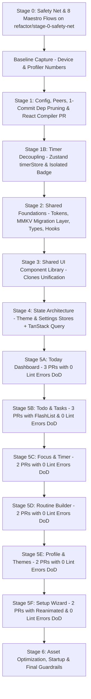

# Zen-app Refactoring & Performance Overhaul Plan

**Date**: 2026-10-23  
**Status**: APPROVED by Engineering Lead (Phase 0 in progress)  
**Strategy**: Staged, branch-per-stage, PR-split, test-verified refactoring.

---

## 1. System Status & Baseline Record

| Dimension | Measured Value / Configuration | Status |
| :--- | :--- | :--- |
| **Expo SDK Version** | **57.0.31** (Latest stable Expo SDK) | Up-to-date |
| **React Native Version** | **0.86.3** | Up-to-date |
| **React Version** | **19.2.3** | Up-to-date |
| **New Architecture** | **Enabled** (`"newArchEnabled": true` in `app.json`) | Active |
| **Hermes Engine** | **Enabled** (Confirmed Hermes Bytecode `.hbc` emitted during export) | Active |
| **React Compiler** | **ESLint rules active, `"reactCompiler": true` currently OFF in `app.json`** | Stage 1 dedicated PR |
| **Hermes Bytecode Bundle** | **7.2 MB** (`entry.hbc`, 3,920 modules bundled) | Tool-measured baseline |
| **Bundled MP3 Audio** | **25.5 MB** across 10 uncompressed MP3 files | Tool-measured baseline |
| **Bundled Vector Fonts** | **5.5 MB** across 18 `@expo/vector-icons` families | Tool-measured baseline |
| **Total Codebase Duplication** | **65 clones / 989 duplicate lines** (4.21% via `jscpd`) | Tool-measured baseline |
| **ESLint Problems** | **179 total** (126 errors, 53 warnings - overwhelmingly `set-state-in-effect`) | Tool-measured baseline |
| **Circular Dependencies** | **0** (via `madge --circular`) | Clean |

---

## 2. Order of Work

---

## 3. Detailed Stage Specifications

### Stage 0: Safety Net & Test Harness
- **Branch**: `refactor/stage-0-safety-net`
- **Objective**: Establish CI, Jest harness, and 8 Maestro E2E smoke tests.
- **Scope**:
  - CI workflow (`.github/workflows/ci.yml`) for `tsc --noEmit`, ESLint, and test runners.
  - Setup Jest + React Native Testing Library harness for shared hooks/utils.
  - Setup Maestro E2E test suite covering **8 critical user flows**:
    1. Flow 1: Onboarding Setup completion (`setup.tsx`).
    2. Flow 2: Today Dashboard navigation & completing routine tasks (`app/(tabs)/index.tsx`).
    3. Flow 3: Task creation, priority toggle, and completion in Todo list (`app/(tabs)/todo.tsx`).
    4. Flow 4: Starting, pausing, and resetting Focus session (`app/focus.tsx`).
    5. Flow 5: Routine builder step creation & reordering (`app/routine.tsx`).
    6. Flow 6: Profile theme selection & custom color preview (`app/(tabs)/profile.tsx`).
    7. **Flow 7 (Storage Persistence Check)**: Kill app process, relaunch, and verify that routines, tasks, and settings persisted.
    8. **Flow 8 (Timer in Background Check)**: Start a debug ~20s timer, background the app, wait 10s, resume app, verify remaining time computed accurately from `targetEndTime - now` without drift. (Also cover math with Jest fake timers).
- **Definition of Done**: CI workflow passes, Jest harness runs sample test, all 8 Maestro YAML flows written and validated.
- **Rollback Plan**: Revert branch to `main`.

---

### Baseline Capture (Before Any Code Changes)
- Record in [`/docs/baseline/`](file:///Users/sarveshvarvatkar/projects/Zen-app/docs/baseline):
  - Cold start (TTI) on release build, low-end Android (via `adb shell am start-activity -W`).
  - Scroll FPS and dropped frames on heaviest lists (Todo, Routine).
  - Render counts for `HomeScreen` and `TodoScreen` during a running timer (React Profiler).
  - JS bundle size (7.2MB) and app APK size.
  - Memory after ~5 minutes of normal use.

---

### Stage 1: Health, Config, Dependency Pruning & React Compiler
- **Branch**: `refactor/stage-1-health-config`
- **Objective**: Fix `expo-doctor` schema errors, install missing peers, prune verified dead dependencies, and enable React Compiler.
- **Scope**:
  - `app.json`: Remove obsolete `android.edgeToEdgeEnabled` and unused `NSCalendarsUsageDescription`.
  - Install missing required peer dependencies: `expo-asset` (for `expo-audio`), `react-native-worklets` (for `react-native-reanimated`).
  - Prune verified dead packages from `package.json` (**one commit per package**, removing `app.json` plugins/permissions/env vars, verifying with `expo-doctor` and clean build):
    - Commit 1: `@supabase/supabase-js` (delete dummy `lib/supabase.ts`)
    - Commit 2: `expo-calendar` (clean infoPlist)
    - Commit 3: `react-native-pager-view`
    - Commit 4: `react-native-tab-view`
    - Commit 5: `@react-native-segmented-control/segmented-control`
  - **Dedicated PR for React Compiler**: Set `"reactCompiler": true` in `app.json` `experiments`. Verify compiled components in React DevTools ("Memo ✨" badge) and list components skipped due to lint errors.
- **Definition of Done**: `npx expo-doctor` passes 100% of checks; clean build succeeds; Maestro smoke tests pass.

---

### Stage 1B: Timer Decoupling (High-Value Optimization)
- **Branch**: `refactor/stage-1b-timer-decoupling`
- **Objective**: Eliminate 1Hz global re-renders across `index.tsx` and `todo.tsx` before touching screens.
- **Scope**:
  - **Store Design**: `stores/timerStore.ts` (Zustand + `useShallow`):
    - Do NOT store or tick `timeLeft` globally!
    - Store holds only: `targetEndTime: number | null`, `isActive: boolean`, `duration: number`, `taskId`, `taskName`, `pomodoroMode`, `pomodoroPhase`, `pomodoroSession`, and actions.
    - Single `setTimeout` to `targetEndTime` for completion logic.
    - Local interval in leaf component (e.g. `ActiveTimerBadge`) computes remaining seconds from `targetEndTime` without triggering any global store changes.
  - **Background Completion & Notification Scheduling**:
    - Preserve exact existing behavior: on `startTimer` or `resumeTimer`, call `scheduleFocusTimerAlarm(title, body, remainingSeconds)`.
    - On `pauseTimer`, `stopTimer`, or completion, call `cancelFocusTimerAlarm()`.
    - On app resume (`AppState`), reconcile `Date.now() >= targetEndTime` and trigger completion if elapsed.
- **Definition of Done**: React Profiler proves **0 re-renders on `index.tsx` and `todo.tsx` while timer counts down**; Maestro Flow 8 passes; Jest fake timers verify math.

---

### Stage 2: Shared Foundations & MMKV Migration Layer
- **Branch**: `refactor/stage-2-shared-foundations`
- **Objective**: Create single-source-of-truth constants, types, domain models, and safe MMKV migration.
- **Scope**:
  - `constants/themeTokens.ts`, `constants/storageKeys.ts`, `types/` domain models.
  - `storage/mmkvMigration.ts`:
    - **One-time idempotent migration**: Runs before any provider reads storage, holding splash screen. Reads all `@zen_*` keys from `AsyncStorage`, batch-writes to MMKV with per-key fallback, sets `@zen_mmkv_migrated_v1 = true`.
    - **Do NOT delete old AsyncStorage data in this release** (ensures rollback safety).
    - **Upgrade-path test procedure**: Install current production release, populate data, install refactored build, verify 100% data retention.
    - Note: MMKV requires dev build (`expo run:android`), does not run in Expo Go.
    - Take advantage of synchronous MMKV to convert hydrate-in-`useEffect` to lazy initial state (`useState(() => mmkv.getString(...))`), eliminating `set-state-in-effect` errors.
  - `hooks/useStorage.ts`, `hooks/useHaptics.ts`, `utils/timeMath.ts`.
- **Definition of Done**: Unit tests for MMKV migration pass with 100% coverage; 0 lint errors on new files.

---

### Stage 3: Shared UI Component Library
- **Branch**: `refactor/stage-3-shared-ui`
- **Objective**: Consolidate code clones into reusable design system components.
- **Scope**:
  - `components/ui/ModalSheet.tsx`: Single bottom sheet (replaces duplicate implementations).
  - `components/forms/TaskForm.tsx`: Unified headless form consolidating `TaskForm.tsx` and `TaskModal.tsx`.
  - `components/forms/TimePicker.tsx`: Cross-platform picker consolidating `InlineTimePicker.tsx` and `WebTimePicker.tsx`.
  - `components/ui/Button.tsx`, `Card.tsx`, `Chip.tsx`, `EmptyState.tsx`.
- **Definition of Done**: 0 lint errors on new components; `jscpd` clones reduced by >50%; Maestro smoke tests pass.

---

### Stage 4: State Architecture & Data Layer
- **Branch**: `refactor/stage-4-state-data`
- **Objective**: Move `ThemeContext` and `SettingsContext` to Zustand and set up TanStack Query.
- **Scope**:
  - `stores/themeStore.ts` & `stores/settingsStore.ts` with direct MMKV persistence.
  - Setup TanStack Query (`@tanstack/react-query`) for PokeAPI theme search (`staleTime: Infinity`).
- **Definition of Done**: Instant theme and settings updates; zero duplicate PokeAPI requests; Maestro smoke tests pass.

---

### Stage 5: Screen Migrations (Ordered by Traffic & Pain)

*Rule: Each screen stage fixes all its own lint errors (including `set-state-in-effect`), virtualizes lists, and is split into 2–3 reviewable PRs.*

#### Stage 5A: Today Dashboard (`app/(tabs)/index.tsx`, 1,559 lines) - Primary Daily Screen
- **PR 1**: Extract timeline card, up-next row, and day progress cards into `components/dashboard/`. Fix all local lint errors.
- **PR 2**: Connect to `timerStore` via selective subscriptions; replace inline cards/chips with Stage 3 primitives.
- **PR 3**: Virtualize heavy routine/event list; measure scroll smoothness and zero timer re-renders.
- **Definition of Done**: 0 lint errors in `index.tsx` and subcomponents; React Compiler compiles with "Memo ✨"; Maestro Flow 2 & 7 pass.

#### Stage 5B: Todo & Tasks (`app/(tabs)/todo.tsx`, 1,766 lines) - Secondary Daily Screen
- **PR 1**: Wire in unified `TaskForm` and `ModalSheet`; delete duplicated modal code.
- **PR 2**: Fix all local `useEffect` state syncing lint errors.
- **PR 3**: Replace unvirtualized `ScrollView` with `@shopify/flash-list` (v2); ensure stable callbacks/props to list rows.
- **Definition of Done**: 0 lint errors; 60 FPS scroll verified with 50+ tasks; Maestro Flow 3 passes.

#### Stage 5C: Focus & Timer (`app/focus.tsx`, 1,651 lines) - Core Productivity Screen
- **PR 1**: Connect to selective `timerStore`; isolate circular timer dial and ambient track selector.
- **PR 2**: Clean audio lifecycle with `expo-audio` (proper unload and resume handling). Fix all local lint errors.
- **Definition of Done**: 0 lint errors; timer ticks isolate to dial; Maestro Flow 4 & 8 pass.

#### Stage 5D: Routine Builder (`app/routine.tsx`, 1,580 lines) - Periodic Management
- **PR 1**: Modularize step list with FlashList and shared `TimePicker`.
- **PR 2**: Extract sequence math into `timeMath.ts`; fix local lint errors.
- **Definition of Done**: 0 lint errors; Maestro Flow 5 passes.

#### Stage 5E: Profile & Themes (`app/(tabs)/profile.tsx`, 553 lines + `ThemeSelectionModal.tsx`, 605 lines)
- **PR 1**: Refactor `ThemeSelectionModal.tsx` to fix all React 19 `set-state-in-effect` violations; replace `Image` with `expo-image`.
- **PR 2**: Wire TanStack Query for debounced PokeAPI searches; connect to `themeStore`.
- **Definition of Done**: 0 lint errors in theme modal and profile card; instant sprite caching; Maestro Flow 6 passes.

#### Stage 5F: Setup / Onboarding Wizard (`app/setup.tsx`, 2,084 lines + `SetupTimeSteps.tsx`, 994 lines) - One-Time Flow
- **PR 1**: Convert JS-thread `Animated` sky gradients and transitions to `react-native-reanimated` worklets.
- **PR 2**: Modularize discrete wizard steps into subcomponents; fix all local lint errors.
- **Definition of Done**: 0 lint errors; zero JS-thread animation bottlenecks; Maestro Flow 1 passes.

---

### Stage 6: Asset Optimization, Startup & Long-Term Guardrails
- **Branch**: `refactor/stage-6-startup-guardrails`
- **Scope**:
  - Audio Optimization: Compress the 10 bundled MP3 files (~60% reduction, verified audio fidelity).
  - Font Optimization: Trim unused `@expo/vector-icons` font files.
  - Startup Coordination: Implement `expo-splash-screen.preventAutoHideAsync()` and `hideAsync()` coordination in `_layout.tsx` holding until MMKV migration completes.
  - Guardrails: Enforce import boundaries and no `useNativeDriver: false`.
  - Re-measure against Baseline: Run all Phase 0 tools and record comparison in `/docs/REFACTOR_RESULTS.md`.
- **Definition of Done**: Full before/after comparison documented; all 8 Maestro flows passing; 0 lint errors repo-wide.
