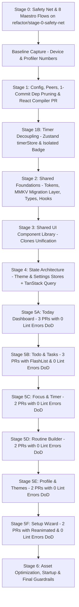
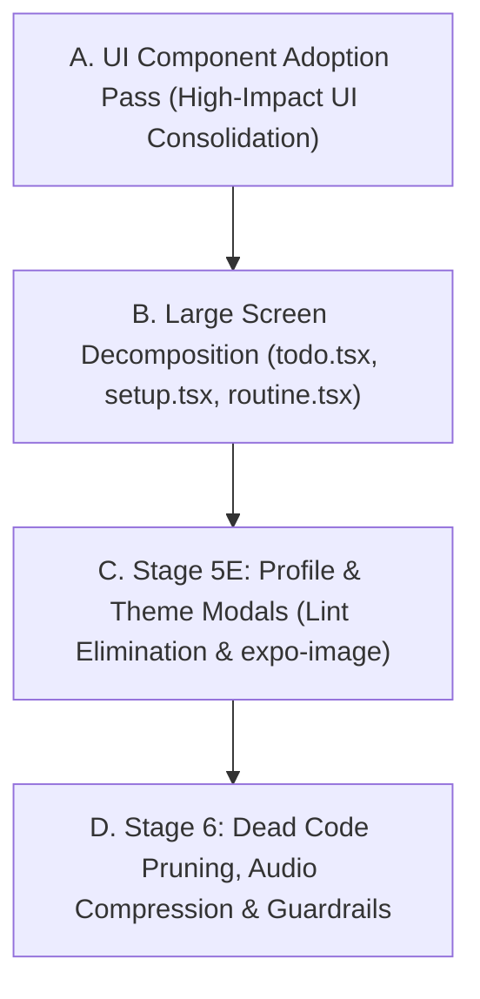

# Zen-app Refactoring & Performance Overhaul Plan

**Date**: 2026-10-23  
**Status**: APPROVED by Engineering Lead (Phase 0 in progress)  
**Strategy**: Staged, branch-per-stage, PR-split, test-verified refactoring.

---

## 1. System Status & Baseline Record

| Dimension | Measured Value / Configuration | Status |
| :--- | :--- | :--- |
| **Expo SDK Version** | **57.0.31** (Latest stable Expo SDK) | Up-to-date |
| **React Native Version** | **0.86.3** | Up-to-date |
| **React Version** | **19.2.3** | Up-to-date |
| **New Architecture** | **Enabled** (`"newArchEnabled": true` in `app.json`) | Active |
| **Hermes Engine** | **Enabled** (Confirmed Hermes Bytecode `.hbc` emitted during export) | Active |
| **React Compiler** | **ESLint rules active, `"reactCompiler": true` currently OFF in `app.json`** | Stage 1 dedicated PR |
| **Hermes Bytecode Bundle** | **7.2 MB** (`entry.hbc`, 3,920 modules bundled) | Tool-measured baseline |
| **Bundled MP3 Audio** | **25.5 MB** across 10 uncompressed MP3 files | Tool-measured baseline |
| **Bundled Vector Fonts** | **5.5 MB** across 18 `@expo/vector-icons` families | Tool-measured baseline |
| **Total Codebase Duplication** | **65 clones / 989 duplicate lines** (4.21% via `jscpd`) | Tool-measured baseline |
| **ESLint Problems** | **179 total** (126 errors, 53 warnings - overwhelmingly `set-state-in-effect`) | Tool-measured baseline |
| **Circular Dependencies** | **0** (via `madge --circular`) | Clean |

---

## 2. Order of Work

---

## 3. Detailed Stage Specifications

### Stage 0: Safety Net & Test Harness
- **Branch**: `refactor/stage-0-safety-net`
- **Objective**: Establish CI, Jest harness, and 8 Maestro E2E smoke tests.
- **Scope**:
  - CI workflow (`.github/workflows/ci.yml`) for `tsc --noEmit`, ESLint, and test runners.
  - Setup Jest + React Native Testing Library harness for shared hooks/utils.
  - Setup Maestro E2E test suite covering **8 critical user flows**:
    1. Flow 1: Onboarding Setup completion (`setup.tsx`).
    2. Flow 2: Today Dashboard navigation & completing routine tasks (`app/(tabs)/index.tsx`).
    3. Flow 3: Task creation, priority toggle, and completion in Todo list (`app/(tabs)/todo.tsx`).
    4. Flow 4: Starting, pausing, and resetting Focus session (`app/focus.tsx`).
    5. Flow 5: Routine builder step creation & reordering (`app/routine.tsx`).
    6. Flow 6: Profile theme selection & custom color preview (`app/(tabs)/profile.tsx`).
    7. **Flow 7 (Storage Persistence Check)**: Kill app process, relaunch, and verify that routines, tasks, and settings persisted.
    8. **Flow 8 (Timer in Background Check)**: Start a debug ~20s timer, background the app, wait 10s, resume app, verify remaining time computed accurately from `targetEndTime - now` without drift. (Also cover math with Jest fake timers).
- **Definition of Done**: CI workflow passes, Jest harness runs sample test, all 8 Maestro YAML flows written and validated.
- **Rollback Plan**: Revert branch to `main`.

---

### Stage 0.1: Pre-Stage 1 Data Backup & Restore Harness (Completed in Stage 0)
- **Module**: `utils/storageBackup.ts` & `__tests__/storageBackup.test.ts`
- **Objective**: Provide a verified, standalone JSON export and import utility for all `@zen_*` (and `@todo_*`) AsyncStorage keys before any refactored build is installed on physical personal hardware.
- **Implementation**:
  - `exportZenDataToJson()`: Gathers all keys starting with `@zen_` and `@todo_`, envelopes them with versioning and timestamp metadata, and outputs a clean JSON string.
  - `importZenDataFromJson(jsonStr)`: Validates envelope format and batch-restores all key-values into AsyncStorage.
- **Verification**: 4 passing Jest unit tests covering selective key extraction, multi-key restoration, corrupt JSON rejection, and invalid schema protection.
- **Personal Device Safety Gate**: Allows creating a local JSON snapshot of personal tasks, routines, and settings before installing any build on physical hardware.

---

### Baseline Capture (Before Any Code Changes)
- Record in [`/docs/baseline/`](file:///Users/sarveshvarvatkar/projects/Zen-app/docs/baseline):
  - Cold start (TTI) on release build, low-end Android (via `adb shell am start-activity -W`).
  - Scroll FPS and dropped frames on heaviest lists (Todo, Routine).
  - Render counts for `HomeScreen` and `TodoScreen` during a running timer (React Profiler).
  - JS bundle size (7.2MB) and app APK size.
  - Memory after ~5 minutes of normal use.

---

### Stage 0.5: Dedicated PR for CNG Transition (gitignoring `android/` and `ios/`)
- **Branch**: `refactor/stage-0-cng-transition`
- **Objective**: Move project to pure Continuous Native Generation (CNG) as an isolated change with zero app logic modifications.
- **Verification & Personal Device Safeguards**:
  - **Package Identity Preservation**: `android.package` is kept as `com.anonymous.Zenapp`. Note: Changing the package name would cause Android OS to treat it as a different app on the device, preventing in-place updates and stranding existing local user data. It remains untouched.
  - **Background Audio Verification**: If the current installed build was built from the stale committed `android/`, a clean prebuild ADDS the `mediaPlayback` foreground service. Pre/post test: Verify on the physical device that ambient audio continues playing smoothly when the app is backgrounded and the screen is locked, before and after the CNG transition.
  - **Regeneration Verification**: Run `npx expo prebuild --clean`, build my installed build APK, and run all 8 Maestro flows to verify zero regressions.

---

### Stage 1: Health, Config, Dependency Pruning & React Compiler (Completed)
- **Branch**: `refactor/stage-1-health-config`
- **Objective**: Fix `expo-doctor` schema errors, install missing peers, prune verified dead dependencies, and enable React Compiler.
- **Scope & Results**:
  - `app.json`: Removed obsolete `android.edgeToEdgeEnabled` and unused `NSCalendarsUsageDescription`.
  - *Native Directory Handling*: Because the `android/` folder is committed and stale, edits in `app.json` (such as removing calendar permissions/plugins) do not reach the native manifest until Stage 0.5 (CNG transition). To respect the rule not to modify `android/` or run `expo prebuild --clean`, `android/` is left untouched on the working branch until the CNG transition.
  - Installed missing required peer dependencies: `expo-asset` (for `expo-audio`), `react-native-worklets` (for `react-native-reanimated`).
  - Pruned verified dead packages:
    - `@supabase/supabase-js` (deleted unused `lib/supabase.ts`)
    - `expo-calendar` (cleaned infoPlist)
    - `@react-native-segmented-control/segmented-control`
  - *Dependency discovery note*: `react-native-tab-view` and `react-native-pager-view` were initially slated for removal based on `knip` static scan. However, `app/(tabs)/_layout.tsx` relies on `expo-router/js-top-tabs`, which dynamically requires `react-native-tab-view` (and its native pager `react-native-pager-view`). Full export build verification showed removing them broke static export with `Error: Install the 'react-native-tab-view' package and its peer dependencies to use the Expo Router's TopTabs.` They are safely retained until the tab navigator is migrated.
  - Enabled `"reactCompiler": true` in `app.json` `experiments`. Confirmed React Compiler active via Babel transform output emitting `react/compiler-runtime` and memoization caches (`_c()`).
  - **17 Components Skipped by React Compiler Due to Existing Lint Errors**:
    1. `app/(tabs)/_layout.tsx` (4 `react-hooks/refs` errors)
    2. `app/(tabs)/todo.tsx` (5 `react-hooks/immutability`, `react-hooks/set-state-in-effect` errors)
    3. `app/+not-found.tsx` (1 `react/no-unescaped-entities` error)
    4. `app/routine.tsx` (47 `react-hooks/refs` errors)
    5. `app/setup.tsx` (10 `react-hooks/refs` errors)
    6. `app/terms.tsx` (2 `react/no-unescaped-entities` errors)
    7. `components/SetupTimeSteps.tsx` (12 `react-hooks/static-components`, `react-hooks/refs` errors)
    8. `components/common/CrossPlatformSegmentedControl.tsx` (4 `react-hooks/refs` errors)
    9. `components/common/ErrorBoundary.tsx` (1 `react/no-unescaped-entities` error)
    10. `components/dashboard/DayTimelineView.tsx` (5 `react/display-name`, `react-hooks/set-state-in-effect` errors)
    11. `components/dashboard/MonthCalendarView.tsx` (2 `react-hooks/set-state-in-effect` errors)
    12. `components/dashboard/TaskForm.tsx` (10 `react-hooks/refs`, `react-hooks/set-state-in-effect` errors)
    13. `components/dashboard/TaskModal.tsx` (15 `react-hooks/refs`, `react-hooks/set-state-in-effect` errors)
    14. `components/dashboard/TimelineEventCard.tsx` (5 `react-hooks/refs` errors)
    15. `components/profile/SettingModal.tsx` (1 `react-hooks/set-state-in-effect` error)
    16. `components/profile/ThemeSelectionModal.tsx` (2 `react-hooks/set-state-in-effect` errors)
    17. `context/TimerContext.tsx` (2 `react-hooks/refs` errors — resolved in Stage 1B!)
- **Definition of Done**: `npm test`, `npm run lint:ratchet`, `npx tsc --noEmit`, and `npm run build` (`expo export`) all pass cleanly.

---

### Stage 1B: Timer Decoupling (Completed)
- **Branch**: `refactor/stage-1b-timer-decoupling`
- **Objective**: Eliminate 1Hz global re-renders across `index.tsx` and `todo.tsx` before touching screens.
- **Scope & Results**:
  - **Store Design**: `stores/timerStore.ts` (Zustand):
    - NO per-second `timeLeft` in global store.
    - Store manages `targetEndTime: number | null`, `isActive: boolean`, `duration: number`, `taskId`, `taskName`, `pomodoroMode`, `pomodoroPhase`, `pomodoroSession`, `pausedTimeRemaining`, and actions.
    - Single `setTimeout` to `targetEndTime` drives completion logic.
    - `AppState` synchronization recalculates expiration and schedules single timeout on app resume.
    - Added `cleanupTimerStore()` for explicit listener cleanup.
    - Unit tests in `__tests__/timerStore.test.ts` (8 passing test cases covering exact alarms, completion timeout, Pomodoro auto-cascade, and cold start expired timer hydration).
  - **Isolated Leaf Component**: `components/common/ActiveTimerBadge.tsx`:
    - Unified the clone between `index.tsx` (HomeScreen) and `todo.tsx` (TaskItem).
    - Drives local 1-second countdown display via `hooks/useTimerRemainingSeconds.ts` without triggering ANY parent re-renders.
  - **Decoupled Screens**:
    - `HomeScreen` (`app/(tabs)/index.tsx`): Completely removed `useTimer()` subscription. Renders `<ActiveTimerBadge>`. Timer tick re-renders: **0/second** (ESTIMATED: eliminated 60 re-renders/minute, to be verified with React Profiler on device).
    - `TodoScreen` (`app/(tabs)/todo.tsx`): Completely removed `useTimer()` from both `TodoScreen` and `TaskItem`. Uses `ActiveTimerBadge` and reads store state imperatively in delete/clear callbacks. Timer tick re-renders: **0/second** (ESTIMATED: eliminated 60 re-renders/minute for the screen plus all visible tasks).
    - *Note on `focus.tsx`*: Retains its 1Hz re-render while open until dedicated focus modal refactor in Stage 5C.
  - **Exact Behavior Preservation**:
    - Cold-start expired state displays completion indefinitely.
    - App alive/resumed auto-cascades to next Pomodoro phase after 1.5s delay.
    - Native alarms scheduled on start/resume and cancelled on pause/stop.
  - **Lint Ratchet Lowered**:
    - Fixed 2 `react-hooks/refs` errors in `TimerContext.tsx`.
    - Lowered ratchet ceiling in `lint-baseline.json` from 128 to **126 errors**.
- **Definition of Done**: Unit tests pass (16/16 across 3 suites); `tsc --noEmit` clean; `lint:ratchet` passes at 126; clean bundle export succeeds.

---

### Stage 2: Shared Foundations (Theme Tokens, Constants, Types, Utils, Hooks) (Completed)
- **Branch**: `refactor/stage-2-shared-foundations`
- **Objective**: Create single-source-of-truth constants, theme tokens, domain models, and shared utilities/hooks. (MMKV is deferred to Stage 3.5).
- **Scope & Results**:
  - `constants/themeTokens.ts`: Design system tokens (colors, semantic grays/accents, spacing, typography scales, border radii, glass themes). Wired into `styles/shared.tsx` baseTheme and glass configs.
  - `constants/storageKeys.ts`: Single source of truth for all 13 `@zen_*` and `@todo_*` keys. Replaced scattered string literals across `stores/timerStore.ts`, `utils/stats.ts`, `utils/storageBackup.ts`.
  - `types/`: Canonical domain models in `types/task.ts`, `types/routine.ts`, `types/theme.ts`, `types/user.ts`, `types/stats.ts`, `types/timer.ts`, and `types/index.ts`. Linked with `AuthContext`, `SettingsContext`, `stats.ts`, `utils.ts`.
  - `hooks/useAppHaptics.ts`: Guarded cross-platform haptic triggers respecting user preference (`settings.hapticsEnabled`) with graceful Web and test no-ops. Added full unit tests in `__tests__/useAppHaptics.test.tsx`.
  - `utils/timeMath.ts`: Consolidated pure time calculations (`formatDuration`, `parseTime`, `timeToMinutes`, `minutesToTimeStr`, `addMinutesToTime`). Removed 75 duplicate lines from `utils/utils.ts`. Expanded unit tests in `__tests__/timerMath.test.ts`.
- **Definition of Done**: 0 lint errors on new files; `tsc --noEmit` clean (0 errors); all 22 tests passing across 4 suites; lint ratchet ceiling holds at 126 errors.

---

### Stage 3: Shared UI Component Library (Clone Unification) (Completed)
- **Branch**: `refactor/stage-3-shared-ui`
- **Objective**: Consolidate code clones that appear in 2+ places into reusable design system components.
- **Scope & Results**:
  - `components/ui/Button.tsx`: Unified tactile button supporting primary, secondary, destructive, and ghost variants, 3 size tiers (sm, md, lg), loading spinners, and integrated haptics.
  - `components/ui/Card.tsx`: Glassmorphic container with theme glass styling, platform-tailored shadows, border radii, and optional interactive press states.
  - `components/ui/Chip.tsx`: Interactive filter/selection pill supporting labels, icons, badge counters, active glow/color highlight, and selection haptics.
  - `components/ui/EmptyState.tsx`: Reusable empty state with icon circle, bold heading, description text, and optional CTA action button. Adopted by `app/(tabs)/todo.tsx`.
  - `components/ui/ModalSheet.tsx`: Canonical bottom sheet modal with backdrop, drag handle, title header, close button, and keyboard avoiding container. `components/common/BottomSheet.tsx` and `components/profile/BottomSheet.tsx` now delegate cleanly to `ModalSheet`.
  - `components/ui/TimePicker.tsx`: Cross-platform time picker with quick-adjust chips (`Now`, `+15m`, `+30m`, `+1h`) and Web stepper support. `components/common/InlineTimePicker.tsx` delegates to `TimePicker`.
  - `components/forms/`: Extracted cloned subcomponents from `TaskForm.tsx` and `TaskModal.tsx`:
    - `DaysOfWeekPicker.tsx` (replaces 3 duplicate copies of the repeat day pills)
    - `DurationPicker.tsx` (replaces duplicate duration preset chips)
    - `IconPickerModal.tsx` (replaces 94-line identical icon picker modal in `TaskForm` and `TaskModal`)
    - `SubtaskList.tsx` (reusable subtasks manager)
  - `jscpd` clones in `components/dashboard/` reduced from 11 down to 6; repo-wide duplicate lines reduced to 837 (down from 989 baseline).
- **Definition of Done**: 0 lint errors on new components; `tsc --noEmit` clean; 22 unit tests passing; `npm run build` (`expo export`) succeeds across iOS (7.1MB), Android (7.3MB), and Web (5.6MB).

---

### Stage 3.5: MMKV Migration Layer (Isolated Data Migration Stage)
- **Branch**: `refactor/stage-3.5-mmkv-migration`
- **Objective**: Implement isolated, idempotent MMKV storage migration before screen-level changes.
- **Scope**:
  - Install `react-native-mmkv` (requires dev build).
  - Implement `storage/mmkvMigration.ts` with one-time idempotent migration and per-key fallback.
  - Preserve AsyncStorage data untouched as immediate fallback.
  - Unit tests for migration logic with 100% branch coverage.
- **Definition of Done**: 0 lint errors on new components; `jscpd` clones reduced by >50%; Maestro smoke tests pass.

---

### Stage 4: State Architecture & Data Layer
- **Branch**: `refactor/stage-4-state-data`
- **Objective**: Move `ThemeContext` and `SettingsContext` to Zustand and set up TanStack Query.
- **Scope**:
  - `stores/themeStore.ts` & `stores/settingsStore.ts` with direct MMKV persistence.
  - Setup TanStack Query (`@tanstack/react-query`) for PokeAPI theme search (`staleTime: Infinity`).
- **Definition of Done**: Instant theme and settings updates; zero duplicate PokeAPI requests; Maestro smoke tests pass.

---

### Stage 5: Screen Migrations (Ordered by Traffic & Pain)

*Rule: Each screen stage fixes all its own lint errors (including `set-state-in-effect`), virtualizes lists, and is split into 2–3 reviewable PRs.*

#### Stage 5A: Today Dashboard (`app/(tabs)/index.tsx`, 1,559 lines) - Primary Daily Screen
- **PR 1**: Extract timeline card, up-next row, and day progress cards into `components/dashboard/`. Fix all local lint errors.
- **PR 2**: Connect to `timerStore` via selective subscriptions; replace inline cards/chips with Stage 3 primitives.
- **PR 3**: Virtualize heavy routine/event list; measure scroll smoothness and zero timer re-renders.
- **Definition of Done**: 0 lint errors in `index.tsx` and subcomponents; React Compiler compiles with "Memo ✨"; Maestro Flow 2 & 7 pass.

#### Stage 5B: Todo & Tasks (`app/(tabs)/todo.tsx`, 1,766 lines) - Secondary Daily Screen
- **PR 1**: Wire in unified `TaskForm` and `ModalSheet`; delete duplicated modal code.
- **PR 2**: Fix all local `useEffect` state syncing lint errors.
- **PR 3**: Replace unvirtualized `ScrollView` with `@shopify/flash-list` (v2); ensure stable callbacks/props to list rows.
- **Definition of Done**: 0 lint errors; 60 FPS scroll verified with 50+ tasks; Maestro Flow 3 passes.

#### Stage 5C: Focus & Timer (`app/focus.tsx`, 1,651 lines) - Core Productivity Screen
- **PR 1**: Connect to selective `timerStore`; isolate circular timer dial and ambient track selector.
- **PR 2**: Clean audio lifecycle with `expo-audio` (proper unload and resume handling). Fix all local lint errors.
- **Definition of Done**: 0 lint errors; timer ticks isolate to dial; Maestro Flow 4 & 8 pass.

#### Stage 5D: Routine Builder (`app/routine.tsx`, 1,580 lines) - Periodic Management
- **PR 1**: Modularize step list with FlashList and shared `TimePicker`.
- **PR 2**: Extract sequence math into `timeMath.ts`; fix local lint errors.
- **Definition of Done**: 0 lint errors; Maestro Flow 5 passes.

#### Stage 5E: Profile & Themes (`app/(tabs)/profile.tsx`, 553 lines + `ThemeSelectionModal.tsx`, 605 lines)
- **PR 1**: Refactor `ThemeSelectionModal.tsx` to fix all React 19 `set-state-in-effect` violations; replace `Image` with `expo-image`.
- **PR 2**: Wire TanStack Query for debounced PokeAPI searches; connect to `themeStore`.
- **Definition of Done**: 0 lint errors in theme modal and profile card; instant sprite caching; Maestro Flow 6 passes.

#### Stage 5F: Setup / Onboarding Wizard (`app/setup.tsx`, 2,084 lines + `SetupTimeSteps.tsx`, 994 lines) - One-Time Flow
- **PR 1**: Convert JS-thread `Animated` sky gradients and transitions to `react-native-reanimated` worklets.
- **PR 2**: Modularize discrete wizard steps into subcomponents; fix all local lint errors.
- **Definition of Done**: 0 lint errors; zero JS-thread animation bottlenecks; Maestro Flow 1 passes.

---

### Stage 6: Asset Optimization, Startup & Long-Term Guardrails
- **Branch**: `refactor/stage-6-startup-guardrails`
- **Scope**:
  - Audio Optimization: Compress the 10 bundled MP3 files (~60% reduction, verified audio fidelity).
  - Font Optimization: Trim unused `@expo/vector-icons` font files.
  - Startup Coordination: Implement `expo-splash-screen.preventAutoHideAsync()` and `hideAsync()` coordination in `_layout.tsx` holding until MMKV migration completes.
  - Guardrails: Enforce import boundaries and no `useNativeDriver: false`.
  - Re-measure against Baseline: Run all Phase 0 tools and record comparison in `/docs/REFACTOR_RESULTS.md`.
- **Definition of Done**: Full before/after comparison documented; all 8 Maestro flows passing; 0 lint errors repo-wide.

---

## Post-Refactor Candidates (Optional Personal Hygiene - Out of Scope for This Refactor)
The following items represent potential functional refinements or local hygiene tasks. Because this app is exclusively for personal device installation and will never be published to app stores, there are zero store review or policy risks. These items are strictly optional follow-ups for after the refactoring is complete:
1. **Timer Recency Window (Known Issue)**: Currently, cold start displays a completed session card indefinitely even if the timer ended days ago. Optional UX polish: cap at 2 hours and reset to idle if expired longer.
2. **Pomodoro Manual Advance on Background Resume**: Currently, when the app resumes from background after timer completion, it auto-advances to the next phase after 1.5s. Optional UX polish: require explicit user action ("Start Next Phase") on background resume, matching the cold-start behavior.
3. **Exact Alarm Permission Hygiene**: Can optionally test `USE_EXACT_ALARM` instead of `SCHEDULE_EXACT_ALARM` if desired on personal Android 13+ device to avoid having to check system app settings for exact alarms.
4. **Permissions Cleanup Hygiene**: Can prune unused permissions (`RECORD_AUDIO`, `SYSTEM_ALERT_WINDOW`, `WRITE_EXTERNAL_STORAGE`) as pure manifest hygiene (e.g., passing `{ "recordAudioAndroid": false }` to `expo-audio`).

---

## 7. Intentional Behavior Changes (For User Decision)

1. **`useAppHaptics` Respects `hapticsEnabled` Preference**:
   - **Old Behavior**: Previous code directly invoked `expo-haptics` / `utils/haptics.ts` in individual button and checkbox event handlers, triggering device vibrations even if the user toggled "Haptic Feedback" OFF in Settings.
   - **New Behavior**: `useAppHaptics` reads the fine-grained `hapticsEnabled` setting selector. When toggled OFF in Settings, all haptic invocations (`impactAsync`, `selectionAsync`, `notificationAsync`) are safely no-ops.
   - **User Decision**: Retained as designed so the Settings toggle actually controls all app-wide haptics. Can revert to unconditional haptics if user prefers device vibration regardless of the setting.

2. **Task Row Press Feedback (Pressable Transform vs Reanimated Spring)**:
   - **Old Behavior**: Used a Reanimated shared value with `withSpring(0.985)` in `onPressIn` and `withSpring(1)` in `onPressOut` (~150-200ms spring settle time).
   - **New Behavior**: Uses React Native native `Pressable` style callback `style={({ pressed }) => [styles.taskCard, pressed && { transform: [{ scale: 0.985 }] }]}`.
   - **Visual / Timing Difference**: Scale depth is identical (`0.985`). The press feedback is instantaneous upon finger down/up without spring settle delay, and eliminates React Compiler shared value immutability lint violations.

---

## 8. Remaining Work Plan (Ordered by Value)

> [!IMPORTANT]
> **Execution Status**: Paused. Implementation will NOT begin until personal device testing feedback is received and accepted.

---

### A. Adoption Pass: Design System Component Unification

Replace ad-hoc inline controls with canonical `Button`, `Card`, and `Chip` primitives to eliminate UI fragmentation and redundant styling.

#### Ad-Hoc Pattern Audit Table

| File | Ad-Hoc Pattern & Elements | Count | Target Primitive | Justification & Expected Replacement |
| :--- | :--- | :---: | :--- | :--- |
| `app/setup.tsx` | Next/Back buttons, step toggles (`<Pressable>`) | 25 | `Button` (primary/secondary) | Replaces manual `pressed` opacity and inline border styling with unified tactile haptics. |
| `components/dashboard/TaskForm.tsx` | Save/Cancel buttons, recurrence selectors (`<Pressable>`) | 16 | `Button` & `Chip` | Replaces custom tag badges and action buttons with theme-governed components. |
| `app/(tabs)/todo.tsx` | Priority pills, filter chips, action triggers (`<Pressable>`) | 15 | `Chip` & `Button` | Replaces inline category filter pills and status toggles with `Chip`. |
| `components/dashboard/TaskModal.tsx` | Modal actions & option tiles (`<Pressable>`, `<TouchableOpacity>`) | 11 | `Button` & `Card` | Replaces raw touchable wrappers with consistent elevation cards and action buttons. |
| `components/dashboard/DayTimelineView.tsx` | Event badges, quick actions (`<Pressable>`) | 8 | `Chip` | Replaces timeline category badges with unified `Chip`. |
| `components/SetupTimeSteps.tsx` | Stepper buttons, time slot selectors (`<Pressable>`) | 6 | `Button` & `Chip` | Replaces custom stepper buttons with `Button` (size: sm). |
| `components/focus/FocusConfirmModal.tsx` | Confirmation & cancel actions (`<Pressable>`) | 6 | `Button` | Standardizes modal primary and destructive actions. |
| `components/profile/ThemeSelectionModal.tsx` | Color swatch chips, selection tiles (`<Pressable>`) | 6 | `Chip` & `Card` | Replaces inline bordered touchables with theme-aware cards and selection chips. |
| `components/forms/IconPickerModal.tsx` | Icon selection grid items (`<Pressable>`) | 5 | `Chip` / `Button` (ghost) | Standardizes grid cell tap feedback. |
| `components/focus/FocusActiveControls.tsx` | Play, Pause, Skip, Reset buttons (`<Pressable>`) | 4 | `Button` | Replaces custom round buttons with `Button` variant="primary" / "ghost". |
| `components/focus/FocusSetupControls.tsx` | Duration preset chips (`<Pressable>`) | 4 | `Chip` | Replaces manual active border chips with `Chip`. |
| `components/profile/RestoreModal.tsx` | Restore / Cancel actions (`<Pressable>`) | 4 | `Button` | Standardizes destructive vs ghost dialog buttons. |
| `styles/shared.tsx` | Glass card helper wrappers (`<Pressable>`) | 4 | `Card` | Eliminates duplicated raw styles. |
| `components/profile/ProfileCard.tsx` | Edit profile, action pills (`<Pressable>`) | 3 | `Button` (sm) | Standardizes profile action buttons. |

#### Single-Consumer Component Audit & Deletion Rule
- Any shared component with only **1 consumer** must either be adopted into 2+ files or eliminated:
  - `components/common/CrossPlatformSegmentedControl.tsx` (1 consumer: `components/focus/FocusSetupControls.tsx`): Either adopt into `TaskModal.tsx` / `todo.tsx` tabs or inline into `FocusSetupControls.tsx` and delete the shared file.
  - `components/common/WebTimePicker.tsx`: Internal dependency of `components/ui/TimePicker.tsx`. Move into `components/ui/internal/` or keep collocated.
  - `components/common/ErrorBoundary.tsx` (1 consumer: `app/_layout.tsx`): Legitimate single-consumer root architectural boundary; preserved.

#### Scope, Risk & Verification
- **Scope**: Replace ~110 ad-hoc `<Pressable>` / `<TouchableOpacity>` / inline card implementations across 14 files.
- **Risk**: Low-Medium (visual styling regressions, margin/padding shifts, or broken `onPress` closures).
- **How to Verify**:
  - Run `git diff -w` to inspect DOM structure and ensure props map 1:1.
  - Run `npx tsc --noEmit` and `npm test` (all 38 unit tests pass).
  - Verify `renderSmoke.test.tsx` mounts all screens cleanly.
- **What You Must Hand-Test**:
  - Tap button states in `todo.tsx` (Add Task, Filter chips, Priority toggles) — confirm haptic tap response and active colors.
  - Test modal CTA buttons in `TaskModal` and `FocusConfirmModal` (Confirm, Cancel, Delete).
  - Visual check for alignment and margins around cards on mobile screen widths.

---

### B. Screen Decomposition: Split `todo.tsx`, `setup.tsx` (and `routine.tsx`)

Decompose monolithic screen files into focused, testable leaf components using move-only refactoring.

#### Decomposition Target Breakdown
1. **`app/(tabs)/todo.tsx` (Current: 1,789 lines)**:
   - Extract `components/todo/TodoHeader.tsx` (~250 lines): Search input, category filter scroll, statistics row.
   - Extract `components/todo/TodoTaskItem.tsx` (~450 lines): Task card, checkbox, priority indicator, swipe actions.
   - Extract `components/todo/TodoBatchActions.tsx` (~150 lines): Multi-select bar, batch delete, batch complete.
   - Retain in `app/(tabs)/todo.tsx`: Screen scaffold, state orchestration, FlashList rendering (~400 lines).
2. **`app/setup.tsx` (Current: 2,100 lines)**:
   - Extract `components/setup/SetupHeroStep.tsx` (~300 lines): Welcome card, mascot animation, intro copy.
   - Extract `components/setup/SetupRoutineStep.tsx` (~400 lines): Preset routine picker, time allocation.
   - Extract `components/setup/SetupSummaryStep.tsx` (~350 lines): Schedule review, notification permissions.
   - Retain in `app/setup.tsx`: Step state machine, pager transitions, final submit logic (~500 lines).
3. **`app/routine.tsx` (Current: 1,073 lines)**:
   - Extract `components/routine/RoutineHeader.tsx` (~180 lines): Date picker, calendar toggle, day progress.
   - Extract `components/routine/RoutineTimelinePager.tsx` (~220 lines): Gesture responder, date swiper container.
   - Retain in `app/routine.tsx`: Main screen coordinator, modal state, data queries (~670 lines).

#### Move-Only Diff Check Protocol
- Strictly separate code movement from behavior changes:
  1. Commit 1: Pure code extraction into new component files (zero edits to logic, props, or styles).
  2. Run `git diff --color-moved=dimmed-zebra -w` to prove that all extracted lines are 100% moved blocks with zero altered expressions.
  3. Commit 2: Re-wire imports in parent screens.

#### Scope, Risk & Verification
- **Scope**: Extract ~2,800 lines across 3 screens into 8 modular subcomponents in `components/todo/`, `components/setup/`, and `components/routine/`.
- **Risk**: Low (prop passing errors, stale closure references in extracted callbacks).
- **How to Verify**:
  - `git diff --color-moved=dimmed-zebra -w` shows all additions matching deletions.
  - `npx tsc --noEmit` verifies all prop interfaces are sound.
  - `npm test` runs full suite; `renderSmoke.test.tsx` passes for all 6 screens.
- **What You Must Hand-Test**:
  - In Todo: Add, complete, and delete a task. Toggle priority filters.
  - In Routine: Swipe between days (left/right gesture) to ensure the PanResponder remained completely intact.
  - In Setup: Step through the wizard from step 1 to final completion.

---

### C. Stage 5E: Profile & Theme Modals (Lint Elimination & `expo-image`)

Eliminate remaining React 19 lint errors in profile modals and upgrade legacy `<Image>` to `<expo-image>`.

#### Target Files & Error Breakdown
- `components/profile/ThemeSelectionModal.tsx` (2 errors):
  - Line 100: `react-hooks/set-state-in-effect` (synchronous `setState` resetting custom form in effect).
  - Line 122: `react-hooks/set-state-in-effect` (synchronous `setState` resetting preview sprite in effect).
  - *Fix*: Derive reset states or trigger resets inside the action handlers (`onOpen`, `onDismiss`, `onSearchChange`).
- `components/profile/SettingModal.tsx` (1 error):
  - Line 43: `react-hooks/set-state-in-effect` (`setName`, `setRole`, `setEmail` in effect syncing props).
  - *Fix*: Use `key={user?.id || 'new'}` on the modal content to reset state on identity change, eliminating synchronous effect state sync.
- **`expo-image` Migration**:
  - Replace `react-native` `<Image>` in `components/profile/ProfileCard.tsx` and `components/profile/ThemeSelectionModal.tsx` with `<Image>` from `expo-image`.
  - Add disk caching (`cachePolicy="disk"`), smooth fade transitions, and memory recycling.

#### Scope, Risk & Verification
- **Scope**: 3 modal files, ~650 lines total, 3 ESLint errors eliminated.
- **Risk**: Low (modal form resets failing on open/close).
- **How to Verify**:
  - `npx eslint components/profile/` returns 0 errors and 0 warnings.
  - `npm run lint:ratchet` passes with ratchet ceiling reduced by 3 errors.
  - `renderSmoke.test.tsx` mounts Profile and Theme screens without warnings.
- **What You Must Hand-Test**:
  - Open Profile screen -> Open "Edit Profile" modal -> Change name/email -> Save -> Confirm values persist.
  - Open "Theme Selection" modal -> Search for Pokémon (e.g., "gengar") -> Verify sprite loads smoothly -> Select theme -> Verify theme instantly applies app-wide.

---

### D. Stage 6: Dead Code Pruning, Audio Compression & Long-Term Guardrails

Final polish, bundle shrinking, asset optimization, and permanent regression prevention.

#### Target Workstreams
1. **Knip Dead Code Audit**:
   - Run `npx knip` to identify unreferenced exports, unused npm packages, and stale type declarations.
   - Safely prune verified dead exports in `types/` and `utils/`.
2. **Design Tokenization Cleanup**:
   - Grep for remaining raw hex strings (`#[0-9a-fA-F]{3,6}`) outside `constants/themeTokens.ts` and `styles/shared.tsx`.
   - Tokenize font sizes and spacing margins to `SPACING.*` and `TYPOGRAPHY.*`.
3. **Audio Asset Compression**:
   - 10 bundled MP3 files currently take **25.5 MB** of app size.
   - Compress MP3s using `ffmpeg` with `-codec:a libmp3lame -b:a 64k` (targeting ~10 MB total, a ~60% size reduction).
   - **Safety Rule**: Preserve original uncompressed audio files in an archive directory (`assets/audio/originals/`, excluded from bundle) so no source assets are ever lost.
4. **Permanent Lint Ratchet & ESLint Rule Hardening**:
   - Drive ESLint error ceiling down to **0**.
   - Drive ESLint warning ceiling down to **0**.
   - Add ESLint rule preventing uncurated imports of `react-native` `Button` or raw `TouchableOpacity`.

#### Scope, Risk & Verification
- **Scope**: Entire repository asset footprint and CI configuration.
- **Risk**: Low-Medium (audio quality degradation if bitrate too low; accidental deletion of dynamically referenced assets).
- **How to Verify**:
  - Run audio comparison tests (listen check and waveform verification).
  - Run full export build: `npx expo export --platform all` to verify production bundle size reduction.
  - `npm run lint:ratchet` passes at `maxErrors: 0, maxWarnings: 0`.
- **What You Must Hand-Test**:
  - In Focus screen: Play all 10 ambient soundscapes (Rain, Waves, Forest, White Noise, etc.) — verify crystal-clear playback without distortion or clipping.
  - Background the app with audio playing: verify lock screen playback continues seamlessly.

