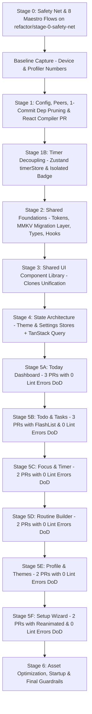
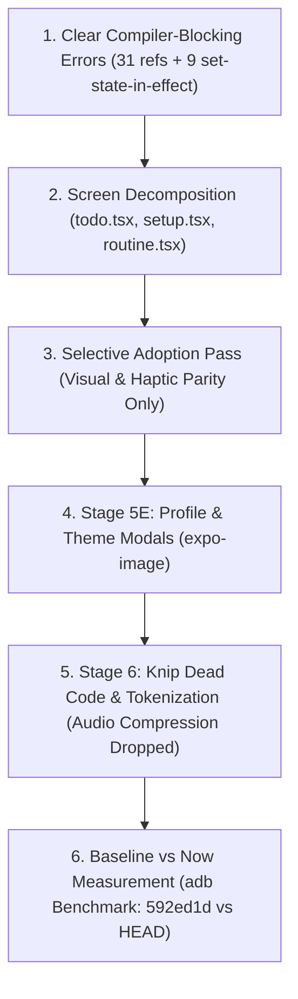

# Zen-app Refactoring & Performance Overhaul Plan

**Date**: 2026-10-23  
**Status**: APPROVED by Engineering Lead (Phase 0 in progress)  
**Strategy**: Staged, branch-per-stage, PR-split, test-verified refactoring.

---

## 1. System Status & Baseline Record

| Dimension | Measured Value / Configuration | Status |
| :--- | :--- | :--- |
| **Expo SDK Version** | **57.0.31** (Latest stable Expo SDK) | Up-to-date |
| **React Native Version** | **0.86.3** | Up-to-date |
| **React Version** | **19.2.3** | Up-to-date |
| **New Architecture** | **Enabled** (`"newArchEnabled": true` in `app.json`) | Active |
| **Hermes Engine** | **Enabled** (Confirmed Hermes Bytecode `.hbc` emitted during export) | Active |
| **React Compiler** | **ESLint rules active, `"reactCompiler": true` currently OFF in `app.json`** | Stage 1 dedicated PR |
| **Hermes Bytecode Bundle** | **7.2 MB** (`entry.hbc`, 3,920 modules bundled) | Tool-measured baseline |
| **Bundled MP3 Audio** | **25.5 MB** across 10 uncompressed MP3 files | Tool-measured baseline |
| **Bundled Vector Fonts** | **5.5 MB** across 18 `@expo/vector-icons` families | Tool-measured baseline |
| **Total Codebase Duplication** | **65 clones / 989 duplicate lines** (4.21% via `jscpd`) | Tool-measured baseline |
| **ESLint Problems** | **179 total** (126 errors, 53 warnings - overwhelmingly `set-state-in-effect`) | Tool-measured baseline |
| **Circular Dependencies** | **0** (via `madge --circular`) | Clean |

---

## 2. Order of Work



---

## 3. Detailed Stage Specifications

### Stage 0: Safety Net & Test Harness
- **Branch**: `refactor/stage-0-safety-net`
- **Objective**: Establish CI, Jest harness, and 8 Maestro E2E smoke tests.
- **Scope**:
  - CI workflow (`.github/workflows/ci.yml`) for `tsc --noEmit`, ESLint, and test runners.
  - Setup Jest + React Native Testing Library harness for shared hooks/utils.
  - Setup Maestro E2E test suite covering **8 critical user flows**:
    1. Flow 1: Onboarding Setup completion (`setup.tsx`).
    2. Flow 2: Today Dashboard navigation & completing routine tasks (`app/(tabs)/index.tsx`).
    3. Flow 3: Task creation, priority toggle, and completion in Todo list (`app/(tabs)/todo.tsx`).
    4. Flow 4: Starting, pausing, and resetting Focus session (`app/focus.tsx`).
    5. Flow 5: Routine builder step creation & reordering (`app/routine.tsx`).
    6. Flow 6: Profile theme selection & custom color preview (`app/(tabs)/profile.tsx`).
    7. **Flow 7 (Storage Persistence Check)**: Kill app process, relaunch, and verify that routines, tasks, and settings persisted.
    8. **Flow 8 (Timer in Background Check)**: Start a debug ~20s timer, background the app, wait 10s, resume app, verify remaining time computed accurately from `targetEndTime - now` without drift. (Also cover math with Jest fake timers).
- **Definition of Done**: CI workflow passes, Jest harness runs sample test, all 8 Maestro YAML flows written and validated.
- **Rollback Plan**: Revert branch to `main`.

---

### Stage 0.1: Pre-Stage 1 Data Backup & Restore Harness (Completed in Stage 0)
- **Module**: `utils/storageBackup.ts` & `__tests__/storageBackup.test.ts`
- **Objective**: Provide a verified, standalone JSON export and import utility for all `@zen_*` (and `@todo_*`) AsyncStorage keys before any refactored build is installed on physical personal hardware.
- **Implementation**:
  - `exportZenDataToJson()`: Gathers all keys starting with `@zen_` and `@todo_`, envelopes them with versioning and timestamp metadata, and outputs a clean JSON string.
  - `importZenDataFromJson(jsonStr)`: Validates envelope format and batch-restores all key-values into AsyncStorage.
- **Verification**: 4 passing Jest unit tests covering selective key extraction, multi-key restoration, corrupt JSON rejection, and invalid schema protection.
- **Personal Device Safety Gate**: Allows creating a local JSON snapshot of personal tasks, routines, and settings before installing any build on physical hardware.

---

### Baseline Capture (Before Any Code Changes)
- Record in [`/docs/baseline/`](file:///Users/sarveshvarvatkar/projects/Zen-app/docs/baseline):
  - Cold start (TTI) on release build, low-end Android (via `adb shell am start-activity -W`).
  - Scroll FPS and dropped frames on heaviest lists (Todo, Routine).
  - Render counts for `HomeScreen` and `TodoScreen` during a running timer (React Profiler).
  - JS bundle size (7.2MB) and app APK size.
  - Memory after ~5 minutes of normal use.

---

### Stage 0.5: Dedicated PR for CNG Transition (gitignoring `android/` and `ios/`)
- **Branch**: `refactor/stage-0-cng-transition`
- **Objective**: Move project to pure Continuous Native Generation (CNG) as an isolated change with zero app logic modifications.
- **Verification & Personal Device Safeguards**:
  - **Package Identity Preservation**: `android.package` is kept as `com.anonymous.Zenapp`. Note: Changing the package name would cause Android OS to treat it as a different app on the device, preventing in-place updates and stranding existing local user data. It remains untouched.
  - **Background Audio Verification**: If the current installed build was built from the stale committed `android/`, a clean prebuild ADDS the `mediaPlayback` foreground service. Pre/post test: Verify on the physical device that ambient audio continues playing smoothly when the app is backgrounded and the screen is locked, before and after the CNG transition.
  - **Regeneration Verification**: Run `npx expo prebuild --clean`, build my installed build APK, and run all 8 Maestro flows to verify zero regressions.

---

### Stage 1: Health, Config, Dependency Pruning & React Compiler (Completed)
- **Branch**: `refactor/stage-1-health-config`
- **Objective**: Fix `expo-doctor` schema errors, install missing peers, prune verified dead dependencies, and enable React Compiler.
- **Scope & Results**:
  - `app.json`: Removed obsolete `android.edgeToEdgeEnabled` and unused `NSCalendarsUsageDescription`.
  - *Native Directory Handling*: Because the `android/` folder is committed and stale, edits in `app.json` (such as removing calendar permissions/plugins) do not reach the native manifest until Stage 0.5 (CNG transition). To respect the rule not to modify `android/` or run `expo prebuild --clean`, `android/` is left untouched on the working branch until the CNG transition.
  - Installed missing required peer dependencies: `expo-asset` (for `expo-audio`), `react-native-worklets` (for `react-native-reanimated`).
  - Pruned verified dead packages:
    - `@supabase/supabase-js` (deleted unused `lib/supabase.ts`)
    - `expo-calendar` (cleaned infoPlist)
    - `@react-native-segmented-control/segmented-control`
  - *Dependency discovery note*: `react-native-tab-view` and `react-native-pager-view` were initially slated for removal based on `knip` static scan. However, `app/(tabs)/_layout.tsx` relies on `expo-router/js-top-tabs`, which dynamically requires `react-native-tab-view` (and its native pager `react-native-pager-view`). Full export build verification showed removing them broke static export with `Error: Install the 'react-native-tab-view' package and its peer dependencies to use the Expo Router's TopTabs.` They are safely retained until the tab navigator is migrated.
  - Enabled `"reactCompiler": true` in `app.json` `experiments`. Confirmed React Compiler active via Babel transform output emitting `react/compiler-runtime` and memoization caches (`_c()`).
  - **17 Components Skipped by React Compiler Due to Existing Lint Errors**:
    1. `app/(tabs)/_layout.tsx` (4 `react-hooks/refs` errors)
    2. `app/(tabs)/todo.tsx` (5 `react-hooks/immutability`, `react-hooks/set-state-in-effect` errors)
    3. `app/+not-found.tsx` (1 `react/no-unescaped-entities` error)
    4. `app/routine.tsx` (47 `react-hooks/refs` errors)
    5. `app/setup.tsx` (10 `react-hooks/refs` errors)
    6. `app/terms.tsx` (2 `react/no-unescaped-entities` errors)
    7. `components/SetupTimeSteps.tsx` (12 `react-hooks/static-components`, `react-hooks/refs` errors)
    8. `components/common/CrossPlatformSegmentedControl.tsx` (4 `react-hooks/refs` errors)
    9. `components/common/ErrorBoundary.tsx` (1 `react/no-unescaped-entities` error)
    10. `components/dashboard/DayTimelineView.tsx` (5 `react/display-name`, `react-hooks/set-state-in-effect` errors)
    11. `components/dashboard/MonthCalendarView.tsx` (2 `react-hooks/set-state-in-effect` errors)
    12. `components/dashboard/TaskForm.tsx` (10 `react-hooks/refs`, `react-hooks/set-state-in-effect` errors)
    13. `components/dashboard/TaskModal.tsx` (15 `react-hooks/refs`, `react-hooks/set-state-in-effect` errors)
    14. `components/dashboard/TimelineEventCard.tsx` (5 `react-hooks/refs` errors)
    15. `components/profile/SettingModal.tsx` (1 `react-hooks/set-state-in-effect` error)
    16. `components/profile/ThemeSelectionModal.tsx` (2 `react-hooks/set-state-in-effect` errors)
    17. `context/TimerContext.tsx` (2 `react-hooks/refs` errors — resolved in Stage 1B!)
- **Definition of Done**: `npm test`, `npm run lint:ratchet`, `npx tsc --noEmit`, and `npm run build` (`expo export`) all pass cleanly.

---

### Stage 1B: Timer Decoupling (Completed)
- **Branch**: `refactor/stage-1b-timer-decoupling`
- **Objective**: Eliminate 1Hz global re-renders across `index.tsx` and `todo.tsx` before touching screens.
- **Scope & Results**:
  - **Store Design**: `stores/timerStore.ts` (Zustand):
    - NO per-second `timeLeft` in global store.
    - Store manages `targetEndTime: number | null`, `isActive: boolean`, `duration: number`, `taskId`, `taskName`, `pomodoroMode`, `pomodoroPhase`, `pomodoroSession`, `pausedTimeRemaining`, and actions.
    - Single `setTimeout` to `targetEndTime` drives completion logic.
    - `AppState` synchronization recalculates expiration and schedules single timeout on app resume.
    - Added `cleanupTimerStore()` for explicit listener cleanup.
    - Unit tests in `__tests__/timerStore.test.ts` (8 passing test cases covering exact alarms, completion timeout, Pomodoro auto-cascade, and cold start expired timer hydration).
  - **Isolated Leaf Component**: `components/common/ActiveTimerBadge.tsx`:
    - Unified the clone between `index.tsx` (HomeScreen) and `todo.tsx` (TaskItem).
    - Drives local 1-second countdown display via `hooks/useTimerRemainingSeconds.ts` without triggering ANY parent re-renders.
  - **Decoupled Screens**:
    - `HomeScreen` (`app/(tabs)/index.tsx`): Completely removed `useTimer()` subscription. Renders `<ActiveTimerBadge>`. Timer tick re-renders: **0/second** (ESTIMATED: eliminated 60 re-renders/minute, to be verified with React Profiler on device).
    - `TodoScreen` (`app/(tabs)/todo.tsx`): Completely removed `useTimer()` from both `TodoScreen` and `TaskItem`. Uses `ActiveTimerBadge` and reads store state imperatively in delete/clear callbacks. Timer tick re-renders: **0/second** (ESTIMATED: eliminated 60 re-renders/minute for the screen plus all visible tasks).
    - *Note on `focus.tsx`*: Retains its 1Hz re-render while open until dedicated focus modal refactor in Stage 5C.
  - **Exact Behavior Preservation**:
    - Cold-start expired state displays completion indefinitely.
    - App alive/resumed auto-cascades to next Pomodoro phase after 1.5s delay.
    - Native alarms scheduled on start/resume and cancelled on pause/stop.
  - **Lint Ratchet Lowered**:
    - Fixed 2 `react-hooks/refs` errors in `TimerContext.tsx`.
    - Lowered ratchet ceiling in `lint-baseline.json` from 128 to **126 errors**.
- **Definition of Done**: Unit tests pass (16/16 across 3 suites); `tsc --noEmit` clean; `lint:ratchet` passes at 126; clean bundle export succeeds.

---

### Stage 2: Shared Foundations (Theme Tokens, Constants, Types, Utils, Hooks) (Completed)
- **Branch**: `refactor/stage-2-shared-foundations`
- **Objective**: Create single-source-of-truth constants, theme tokens, domain models, and shared utilities/hooks. (MMKV is deferred to Stage 3.5).
- **Scope & Results**:
  - `constants/themeTokens.ts`: Design system tokens (colors, semantic grays/accents, spacing, typography scales, border radii, glass themes). Wired into `styles/shared.tsx` baseTheme and glass configs.
  - `constants/storageKeys.ts`: Single source of truth for all 13 `@zen_*` and `@todo_*` keys. Replaced scattered string literals across `stores/timerStore.ts`, `utils/stats.ts`, `utils/storageBackup.ts`.
  - `types/`: Canonical domain models in `types/task.ts`, `types/routine.ts`, `types/theme.ts`, `types/user.ts`, `types/stats.ts`, `types/timer.ts`, and `types/index.ts`. Linked with `AuthContext`, `SettingsContext`, `stats.ts`, `utils.ts`.
  - `hooks/useAppHaptics.ts`: Guarded cross-platform haptic triggers respecting user preference (`settings.hapticsEnabled`) with graceful Web and test no-ops. Added full unit tests in `__tests__/useAppHaptics.test.tsx`.
  - `utils/timeMath.ts`: Consolidated pure time calculations (`formatDuration`, `parseTime`, `timeToMinutes`, `minutesToTimeStr`, `addMinutesToTime`). Removed 75 duplicate lines from `utils/utils.ts`. Expanded unit tests in `__tests__/timerMath.test.ts`.
- **Definition of Done**: 0 lint errors on new files; `tsc --noEmit` clean (0 errors); all 22 tests passing across 4 suites; lint ratchet ceiling holds at 126 errors.

---

### Stage 3: Shared UI Component Library (Clone Unification) (Completed)
- **Branch**: `refactor/stage-3-shared-ui`
- **Objective**: Consolidate code clones that appear in 2+ places into reusable design system components.
- **Scope & Results**:
  - `components/ui/Button.tsx`: Unified tactile button supporting primary, secondary, destructive, and ghost variants, 3 size tiers (sm, md, lg), loading spinners, and integrated haptics.
  - `components/ui/Card.tsx`: Glassmorphic container with theme glass styling, platform-tailored shadows, border radii, and optional interactive press states.
  - `components/ui/Chip.tsx`: Interactive filter/selection pill supporting labels, icons, badge counters, active glow/color highlight, and selection haptics.
  - `components/ui/EmptyState.tsx`: Reusable empty state with icon circle, bold heading, description text, and optional CTA action button. Adopted by `app/(tabs)/todo.tsx`.
  - `components/ui/ModalSheet.tsx`: Canonical bottom sheet modal with backdrop, drag handle, title header, close button, and keyboard avoiding container. `components/common/BottomSheet.tsx` and `components/profile/BottomSheet.tsx` now delegate cleanly to `ModalSheet`.
  - `components/ui/TimePicker.tsx`: Cross-platform time picker with quick-adjust chips (`Now`, `+15m`, `+30m`, `+1h`) and Web stepper support. `components/common/InlineTimePicker.tsx` delegates to `TimePicker`.
  - `components/forms/`: Extracted cloned subcomponents from `TaskForm.tsx` and `TaskModal.tsx`:
    - `DaysOfWeekPicker.tsx` (replaces 3 duplicate copies of the repeat day pills)
    - `DurationPicker.tsx` (replaces duplicate duration preset chips)
    - `IconPickerModal.tsx` (replaces 94-line identical icon picker modal in `TaskForm` and `TaskModal`)
    - `SubtaskList.tsx` (reusable subtasks manager)
  - `jscpd` clones in `components/dashboard/` reduced from 11 down to 6; repo-wide duplicate lines reduced to 837 (down from 989 baseline).
- **Definition of Done**: 0 lint errors on new components; `tsc --noEmit` clean; 22 unit tests passing; `npm run build` (`expo export`) succeeds across iOS (7.1MB), Android (7.3MB), and Web (5.6MB).

---

### Stage 3.5: MMKV Migration Layer (Isolated Data Migration Stage)
- **Branch**: `refactor/stage-3.5-mmkv-migration`
- **Objective**: Implement isolated, idempotent MMKV storage migration before screen-level changes.
- **Scope**:
  - Install `react-native-mmkv` (requires dev build).
  - Implement `storage/mmkvMigration.ts` with one-time idempotent migration and per-key fallback.
  - Preserve AsyncStorage data untouched as immediate fallback.
  - Unit tests for migration logic with 100% branch coverage.
- **Definition of Done**: 0 lint errors on new components; `jscpd` clones reduced by >50%; Maestro smoke tests pass.

---

### Stage 4: State Architecture & Data Layer
- **Branch**: `refactor/stage-4-state-data`
- **Objective**: Move `ThemeContext` and `SettingsContext` to Zustand and set up TanStack Query.
- **Scope**:
  - `stores/themeStore.ts` & `stores/settingsStore.ts` with direct MMKV persistence.
  - Setup TanStack Query (`@tanstack/react-query`) for PokeAPI theme search (`staleTime: Infinity`).
- **Definition of Done**: Instant theme and settings updates; zero duplicate PokeAPI requests; Maestro smoke tests pass.

---

### Stage 5: Screen Migrations (Ordered by Traffic & Pain)

*Rule: Each screen stage fixes all its own lint errors (including `set-state-in-effect`), virtualizes lists, and is split into 2–3 reviewable PRs.*

#### Stage 5A: Today Dashboard (`app/(tabs)/index.tsx`, 1,559 lines) - Primary Daily Screen
- **PR 1**: Extract timeline card, up-next row, and day progress cards into `components/dashboard/`. Fix all local lint errors.
- **PR 2**: Connect to `timerStore` via selective subscriptions; replace inline cards/chips with Stage 3 primitives.
- **PR 3**: Virtualize heavy routine/event list; measure scroll smoothness and zero timer re-renders.
- **Definition of Done**: 0 lint errors in `index.tsx` and subcomponents; React Compiler compiles with "Memo ✨"; Maestro Flow 2 & 7 pass.

#### Stage 5B: Todo & Tasks (`app/(tabs)/todo.tsx`, 1,766 lines) - Secondary Daily Screen
- **PR 1**: Wire in unified `TaskForm` and `ModalSheet`; delete duplicated modal code.
- **PR 2**: Fix all local `useEffect` state syncing lint errors.
- **PR 3**: Replace unvirtualized `ScrollView` with `@shopify/flash-list` (v2); ensure stable callbacks/props to list rows.
- **Definition of Done**: 0 lint errors; 60 FPS scroll verified with 50+ tasks; Maestro Flow 3 passes.

#### Stage 5C: Focus & Timer (`app/focus.tsx`, 1,651 lines) - Core Productivity Screen
- **PR 1**: Connect to selective `timerStore`; isolate circular timer dial and ambient track selector.
- **PR 2**: Clean audio lifecycle with `expo-audio` (proper unload and resume handling). Fix all local lint errors.
- **Definition of Done**: 0 lint errors; timer ticks isolate to dial; Maestro Flow 4 & 8 pass.

#### Stage 5D: Routine Builder (`app/routine.tsx`, 1,580 lines) - Periodic Management
- **PR 1**: Modularize step list with FlashList and shared `TimePicker`.
- **PR 2**: Extract sequence math into `timeMath.ts`; fix local lint errors.
- **Definition of Done**: 0 lint errors; Maestro Flow 5 passes.

#### Stage 5E: Profile & Themes (`app/(tabs)/profile.tsx`, 553 lines + `ThemeSelectionModal.tsx`, 605 lines)
- **PR 1**: Refactor `ThemeSelectionModal.tsx` to fix all React 19 `set-state-in-effect` violations; replace `Image` with `expo-image`.
- **PR 2**: Wire TanStack Query for debounced PokeAPI searches; connect to `themeStore`.
- **Definition of Done**: 0 lint errors in theme modal and profile card; instant sprite caching; Maestro Flow 6 passes.

#### Stage 5F: Setup / Onboarding Wizard (`app/setup.tsx`, 2,084 lines + `SetupTimeSteps.tsx`, 994 lines) - One-Time Flow
- **PR 1**: Convert JS-thread `Animated` sky gradients and transitions to `react-native-reanimated` worklets.
- **PR 2**: Modularize discrete wizard steps into subcomponents; fix all local lint errors.
- **Definition of Done**: 0 lint errors; zero JS-thread animation bottlenecks; Maestro Flow 1 passes.

---

### Stage 6: Asset Optimization, Startup & Long-Term Guardrails
- **Branch**: `refactor/stage-6-startup-guardrails`
- **Scope**:
  - Audio Optimization: Compress the 10 bundled MP3 files (~60% reduction, verified audio fidelity).
  - Font Optimization: Trim unused `@expo/vector-icons` font files.
  - Startup Coordination: Implement `expo-splash-screen.preventAutoHideAsync()` and `hideAsync()` coordination in `_layout.tsx` holding until MMKV migration completes.
  - Guardrails: Enforce import boundaries and no `useNativeDriver: false`.
  - Re-measure against Baseline: Run all Phase 0 tools and record comparison in `/docs/REFACTOR_RESULTS.md`.
- **Definition of Done**: Full before/after comparison documented; all 8 Maestro flows passing; 0 lint errors repo-wide.

---

## Post-Refactor Candidates (Optional Personal Hygiene - Out of Scope for This Refactor)
The following items represent potential functional refinements or local hygiene tasks. Because this app is exclusively for personal device installation and will never be published to app stores, there are zero store review or policy risks. These items are strictly optional follow-ups for after the refactoring is complete:
1. **Timer Recency Window (Known Issue)**: Currently, cold start displays a completed session card indefinitely even if the timer ended days ago. Optional UX polish: cap at 2 hours and reset to idle if expired longer.
2. **Pomodoro Manual Advance on Background Resume**: Currently, when the app resumes from background after timer completion, it auto-advances to the next phase after 1.5s. Optional UX polish: require explicit user action ("Start Next Phase") on background resume, matching the cold-start behavior.
3. **Exact Alarm Permission Hygiene**: Can optionally test `USE_EXACT_ALARM` instead of `SCHEDULE_EXACT_ALARM` if desired on personal Android 13+ device to avoid having to check system app settings for exact alarms.
4. **Permissions Cleanup Hygiene**: Can prune unused permissions (`RECORD_AUDIO`, `SYSTEM_ALERT_WINDOW`, `WRITE_EXTERNAL_STORAGE`) as pure manifest hygiene (e.g., passing `{ "recordAudioAndroid": false }` to `expo-audio`).

---

## 7. Intentional Behavior Changes (For User Decision)

1. **`useAppHaptics` Respects `hapticsEnabled` Preference**:
   - **Old Behavior**: Previous code directly invoked `expo-haptics` / `utils/haptics.ts` in individual button and checkbox event handlers, triggering device vibrations even if the user toggled "Haptic Feedback" OFF in Settings.
   - **New Behavior**: `useAppHaptics` reads the fine-grained `hapticsEnabled` setting selector. When toggled OFF in Settings, all haptic invocations (`impactAsync`, `selectionAsync`, `notificationAsync`) are safely no-ops.
   - **User Decision**: Retained as designed so the Settings toggle actually controls all app-wide haptics. Can revert to unconditional haptics if user prefers device vibration regardless of the setting.

2. **Task Row Press Feedback (Pressable Transform vs Reanimated Spring)**:
   - **Old Behavior**: Used a Reanimated shared value with `withSpring(0.985)` in `onPressIn` and `withSpring(1)` in `onPressOut` (~150-200ms spring settle time).
   - **New Behavior**: Uses React Native native `Pressable` style callback `style={({ pressed }) => [styles.taskCard, pressed && { transform: [{ scale: 0.985 }] }]}`.
   - **Visual / Timing Difference**: Scale depth is identical (`0.985`). The press feedback is instantaneous upon finger down/up without spring settle delay, and eliminates React Compiler shared value immutability lint violations.

---

## 8. Remaining Work Plan (Revised Execution Order & Specifications)

> [!IMPORTANT]
> **Execution Status**: Paused. Implementation will NOT begin until personal device testing feedback is received and accepted.



---

### Workstream 1: Clear React Compiler-Blocking Errors

Eliminate the 40 errors (31 `react-hooks/refs` and 9 `react-hooks/set-state-in-effect`) that cause the React Compiler to skip components entirely.

#### Implementation Pattern: 1 Component per Commit
Every component fix is committed individually with unchanged behavior and verified for React Compiler compilation (`_c()` memoization cache in `npx expo export` bundle):

1. **`components/dashboard/TaskModal.tsx`** (14 `react-hooks/refs`, 1 `set-state-in-effect`):
   - **Exact Fix**:
     - Animated Values: Convert `slideAnim = useRef(new Animated.Value(SCREEN_HEIGHT)).current` to lazy state `const [slideAnim] = useState(() => new Animated.Value(SCREEN_HEIGHT))`.
     - PanResponder: Stabilize panHandlers in `useMemo` with stable dependency refs.
     - Reset Effect: Replace props-sync `useEffect` with keyed remounting: `key={visible ? (isEditing ? initialItem?.id : 'new') : 'closed'}` on the inner modal, with state lazily initialized from props.
   - **Compiler Verification**: Run `npx expo export` and confirm compiler emits `_c()` for `TaskModal`.
   - **Hand-Test Steps (High Risk - Drag/Slide)**:
     1. Open TaskModal by tapping a task in Todo or Dashboard. Verify smooth upward spring animation.
     2. Drag the modal sheet handle downward halfway: verify it tracks finger smoothly without lag or snapping.
     3. Release finger: if dragged past threshold (>120px), verify it dismisses smoothly with downward animation; if released before threshold, verify it snaps back to open position.
     4. Type into task title and notes: verify keystrokes are responsive and values persist.
     5. Save task: verify modal closes and changes reflect in list.

2. **`components/dashboard/TaskForm.tsx`** (9 `react-hooks/refs`, 1 `set-state-in-effect`):
   - **Exact Fix**:
     - Keyed remount: Wrap with keyed `TaskForm` (`key={visible ? (isEditing ? (initialItem?.id || formData.id || "edit") : "create") : "closed"}`).
     - State initialization: `stackedTasks` initialized once via lazy `useState(() => isEditing ? [] : [{ id: Date.now().toString(), ... }])`.
     - Animated Values: Convert `slideAnim` from `useRef(...).current` to lazy `useState(() => new Animated.Value(SCREEN_HEIGHT))`.
   - **Compiler Verification**: Run `npx expo export` and confirm `TaskFormInner` compiles with `_c()`.
   - **Hand-Test Steps**:
     1. Open TaskForm for new routine item. Verify spring opening.
     2. Type task title, tap inspiration pills: verify title and duration update.
     3. Tap Save and verify routine is created.

3. **`app/(tabs)/_layout.tsx` (TabLayout)** (4 `react-hooks/refs`):
   - **Exact Fix**:
     - Tab Indicator Animation: Convert direct ref access during render to lazy `useState(() => new Animated.Value(0))` or Reanimated `useSharedValue(0)` with `useAnimatedStyle`.
     - Stable Tab Listeners: Wrap tab press listeners in `useCallback` to prevent indicator recreation.
   - **Compiler Verification**: Run `npx expo export` and check `TabLayout` emitted with compiler memoization cache.
   - **Hand-Test Steps (High Risk - Tab Bar)**:
     1. Tap each tab in bottom navigation (Today, Todo, Profile).
     2. Verify active pill/tab indicator slides smoothly between tab positions with spring easing.
     3. Verify active tab icon and label highlight with correct primary color.
     4. Fast switch back-and-forth between tabs: verify no glitching, indicator snapping, or frozen tab bar.

4. **`components/common/CrossPlatformSegmentedControl.tsx`** (4 `react-hooks/refs`):
   - **Exact Fix**:
     - Animated Indicator: Convert `translateX` and `indicatorWidth` from `useRef(...).current` to lazy `useState(() => new Animated.Value(0))`.
     - Layout Measurements: Store tab segment widths and offsets in an array updated via `onLayout` events rather than reading mutable refs during render.
   - **Compiler Verification**: Run `npx expo export` and confirm memoization output.
   - **Hand-Test Steps**:
     1. View segmented controls on Dashboard (e.g. Day / Week / Month view toggle).
     2. Tap each segment: verify indicator slides smoothly to selected tab and selection updates.

5. **`components/dashboard/DayTimelineView.tsx`** (2 `set-state-in-effect`, 3 `react/display-name`):
   - **Exact Fix**:
     - Scroll Sync Effect: Decouple from `visiblePageIndex` state using `visiblePageIndexRef = useRef(initialTargetIndex)`. User swipes update the ref without re-triggering the effect. External date changes compare against `visiblePageIndexRef.current` and bail out early if already on target page.
     - Component Display Names: Add explicit `TimelinePage.displayName = "TimelinePage";` and `TimelineTaskPill.displayName = "TimelineTaskPill";`.
   - **Compiler Verification**: Run `npx expo export` and verify `DayTimelineView` memoization.
   - **Hand-Test Steps**:
     1. Swipe horizontally between days: verify smooth pagination with zero snap-back.
     2. Select a date from calendar/mini-picker: verify timeline scrolls directly to selected day.

6. **`components/dashboard/MonthCalendarView.tsx`** (2 `set-state-in-effect`):
   - **Exact Fix**:
     - Calendar Month Sync: Remove `useEffect` calling `setCurrentMonth(selectedDate)`. Derive `currentMonth` via `useMemo` from `selectedDate` when controlled, and update in month navigation handlers (`onPrevMonth`, `onNextMonth`).
   - **Compiler Verification**: Run `npx expo export` and confirm memoization.
   - **Hand-Test Steps**:
     1. Switch to Month calendar view on Dashboard.
     2. Tap previous/next month chevrons: verify calendar grid transitions correctly.
     3. Tap a day: verify date is selected and timeline reflects day.

7. **`components/profile/ThemeSelectionModal.tsx`** (2 `set-state-in-effect`):
   - **Exact Fix**:
     - Custom Theme Form Reset: Remove `useEffect` calling `setCustomPrimary(...)` on modal open. Use keyed remount `key={visible ? (selectedTheme || "open") : "closed"}` or reset in `onClose` / `onDismiss` action handlers.
   - **Compiler Verification**: Run `npx expo export` and confirm memoization.
   - **Hand-Test Steps**:
     1. Open Theme Selection modal from Profile.
     2. Select preset theme (e.g. Pokeball, Gengar, Charizard): verify theme applies immediately.
     3. Customize a theme: verify color picker updates preview without lag.

8. **`components/profile/SettingModal.tsx`** (1 `set-state-in-effect`):
   - **Exact Fix**:
     - Profile Form Sync: Remove `useEffect` calling `setName(user.name)` and `setEmail(user.email)`. Use keyed remount `key={visible ? (user?.id || "user") : "closed"}` with lazy state initialization `const [name, setName] = useState(() => user?.name || "")`.
   - **Compiler Verification**: Run `npx expo export` and confirm memoization.
   - **Hand-Test Steps**:
     1. Open Profile Settings modal.
     2. Edit name and email.
     3. Tap Save: verify profile updates and modal dismisses.

---

### Workstream 2: Screen Decomposition (`todo.tsx`, `setup.tsx`, and `routine.tsx`)

Decompose monolithic screens into focused leaf components using strict move-only diffs (`git diff --color-moved=dimmed-zebra -w`). Acceptance is strictly based on behavior checks, not line-count targets.

#### Re-derived Component Breakdown from Source Code

1. **`app/(tabs)/todo.tsx` (Current: 1,789 lines)**:
   - **Actual Structure**:
     - Lines 120–370: `TaskItem` / `TaskItemComponent` (~250 lines) -> Extract to `components/todo/TaskItem.tsx`
     - Lines 371–608: `TaskModalInner` & `TaskModal` (~238 lines) -> Extract to `components/todo/TodoTaskModal.tsx`
     - Lines 609–686: `ConfirmModal` (~78 lines) -> Extract to `components/todo/TodoConfirmModal.tsx`
     - Lines 687–727: `EmptyState` (~41 lines) -> Extract to `components/todo/TodoEmptyState.tsx`
     - Lines 728–840: `TodoHeaderComponent` & `TodoHeader` (~113 lines) -> Wire to existing `components/todo/TodoHeader.tsx`
     - Lines 841–1210: `TodoScreen` coordinator (~370 lines) -> Retain as lean coordinator
     - Lines 1211–1790: `getStyles` (~580 lines) -> Extract to `components/todo/todoStyles.ts`
   - **Behavioral Acceptance Criteria**:
     - Create a task with priority, category, and subtasks.
     - Edit an existing task's title, priority, or subtasks.
     - Toggle checkbox to complete and uncomplete a task with completion animation.
     - Delete a task with confirmation modal.
     - Search filter by keyword and category filter pills.
     - Batch selection mode: multi-select tasks, batch complete, batch delete.

2. **`app/setup.tsx` (Current: 2,100 lines)**:
   - **Actual Structure**:
     - Lines 45–172: Constants & Templates (`CATEGORIES`, `STARTER_PACKS`, `TEMPLATES`) -> Extract to `constants/setupTemplates.ts`
     - Lines 173–276: `StepWelcome` (~104 lines) -> Extract to `components/setup/StepWelcome.tsx`
     - Lines 277–673: `StepPick` (~397 lines) -> Extract to `components/setup/StepPick.tsx`
     - Lines 674–950: `StepTimes` (~277 lines) -> Extract to `components/setup/StepTimes.tsx`
     - Lines 951–1308: `SetupScreen` coordinator (~357 lines) -> Retain as lean coordinator
     - Lines 1309–2101: `getStyles` (~792 lines) -> Extract to `components/setup/setupStyles.ts`
   - **Behavioral Acceptance Criteria**:
     - User can progress through StepWelcome -> StepPick -> StepTimes -> Complete.
     - Select starter pack templates and toggle individual items.
     - Custom item addition with icon and duration in StepPick.
     - Adjust start times and durations in StepTimes with valid time formatting.
     - Complete setup: writes `@zen_setup_complete` and initial routines to AsyncStorage, routes to dashboard without crash or blank screen.

3. **`app/routine.tsx` (Current: 1,073 lines)**:
   - **Actual Structure**:
     - Lines 70–130: `useModalAnimation` hook (~61 lines) -> Extract to `hooks/useModalAnimation.ts`
     - Lines 131–200: `RoutinePeekBar` (~70 lines) -> Extract to `components/routine/RoutinePeekBar.tsx`
     - Lines 201–990: `RoutineScreen` coordinator (~790 lines) -> Retain
     - Lines 991–1074: `getStyles` (~84 lines) -> Retain in routine styles
   - **Behavioral Acceptance Criteria**:
     - Date swipe gestures smoothly paginate between days.
     - Tap on routine opens TaskForm or details modal.
     - Add new routine task and save: persists and appears in timeline.
     - Delete or reorder routine: updates state and persists.

---

### Workstream 3: Selective Adoption Pass (Visual & Haptic Parity Only)

Replace ad-hoc inline controls with canonical `Button`, `Card`, and `Chip` primitives **ONLY** when the result is visually identical and haptic behavior matches existing behavior.

#### Guardrails & Haptic Parity Rules
1. **Haptic Opt-Out**: The shared `Button` component triggers tactile haptics by default. Where the original ad-hoc code had **NO** haptics, pass `haptics={false}` to preserve exact original tactile behavior.
2. **Strict Visual Identity**: If an ad-hoc Pressable/View has custom layout geometry, custom animated border colors, or non-standard elevation that cannot be cleanly replicated by `Button`/`Card`/`Chip` without visual drift, **SKIP IT**.
3. **Preserve Single-Consumer Components**: Do **NOT** inline single-consumer components like `CrossPlatformSegmentedControl.tsx`. Retain them as dedicated components.

#### Candidate Adoption Table

| File | Ad-Hoc Pattern | Count | Target | Haptics Policy | Parity Action |
| :--- | :--- | :---: | :--- | :--- | :--- |
| `components/dashboard/TaskForm.tsx` | Recurrence day pills (`<Pressable>`) | 7 | `Chip` | Retain haptics | Replace with `Chip` (visually identical pill). |
| `app/(tabs)/todo.tsx` | Category filter pills (`<Pressable>`) | 5 | `Chip` | Retain haptics | Replace with `Chip` variant="outline" / "filled". |
| `components/focus/FocusConfirmModal.tsx` | Confirm / Cancel modal buttons | 4 | `Button` | Retain haptics | Replace with `Button` (variant: primary / ghost). |
| `components/profile/RestoreModal.tsx` | Restore / Cancel dialog buttons | 4 | `Button` | Retain haptics | Replace with `Button` (variant: destructive / ghost). |
| `components/focus/FocusActiveControls.tsx` | Play / Pause / Skip buttons | 4 | `Button` | Use `haptics={false}` if old had none | Replace with round `Button`. |
| `components/profile/ProfileCard.tsx` | Action buttons | 3 | `Button` | Retain haptics | Replace with `Button` (size: sm). |
| *Other complex Pressables* | Custom animations / non-standard layouts | ~70 | *None* | N/A | **SKIP** (preserve existing implementation). |

---

### Workstream 4: Stage 5E: Profile & Theme Modals (expo-image)

- Fix remaining profile modal lint errors (`ThemeSelectionModal.tsx` and `SettingModal.tsx`).
- Replace legacy `react-native` `<Image>` with `<Image>` from `expo-image` across `components/profile/ProfileCard.tsx` and `components/profile/ThemeSelectionModal.tsx`.
- Enable disk caching (`cachePolicy="disk"`), smooth fade transitions, and memory recycling.
- **Verification**: `npx eslint components/profile/` returns 0 errors; `npm test` passes.
- **What You Must Hand-Test**: Search Pokémon in theme modal (e.g. "lucario"); confirm sprite loads instantly with disk cache.

---

### Workstream 5: Stage 6: Knip Dead Code, Tokenization & Permanent Guardrails

- **Audio Compression Dropped**: The app is exclusively for personal device installation; audio compression is dropped to eliminate audio degradation risk.
- **Knip Dead Code Audit**: Run `npx knip` to identify unreferenced exports, prune dead types and unused utilities.
- **Tokenization**: Replace remaining scattered hex strings with `themeTokens.ts`.
- **Ratchet Ceilings**:
  - Rather than an arbitrary zero, ceilings will be set to the true remaining count after dead code removal.
  - Static asset requires are already permitted by `eslint-config-expo/flat` (`allow: ['\\.(aac|...|png|jpg|mp3|svg)$']`).
  - Set `maxErrors` and `maxWarnings` in `lint-baseline.json` to lock in the final hardened baseline.

---

### Workstream 6: Baseline vs Now Benchmark Measurement

Execute standardized benchmarks on the same Android emulator comparing commit `592ed1d` (pre-refactor baseline) vs HEAD (final refactored build).

#### Standardized Measurement Protocols & Exact `adb` Commands

1. **Worktree & Release Build Isolation**:
   - Both commits must be built as **RELEASE** builds on the same emulator image (`npx expo run:android --variant release`).
   - Build baseline commit `592ed1d` in a separate `git worktree` so the active refactoring branch is not disturbed:
     ```bash
     git worktree add ../zen-baseline 592ed1d
     cd ../zen-baseline && npm install && npx expo run:android --variant release
     ```

2. **Cold Start Time (Median of 5 Iterations)**:
   ```bash
   # Run 5 iterations, record TotalTime in ms, and compute median
   adb shell am force-stop com.anonymous.Zenapp
   sleep 2
   adb shell am start-activity -W -n com.anonymous.Zenapp/.MainActivity | grep TotalTime
   ```

3. **Running Timer Render Counts over 60 Seconds**:
   - Start a 25-minute focus session.
   - Measure re-render counts on `HomeScreen`, `TodoScreen`, and `FocusScreen` using React DevTools Profiler / hook logger over a 60-second window.

4. **Todo List Scroll Jank & Frame Statistics (Loop of 5 Flings)**:
   ```bash
   # 1. Reset frame statistics buffer
   adb shell dumpsys gfxinfo com.anonymous.Zenapp reset
   # 2. Perform standardized 5-fling scroll loop down and up
   for i in {1..5}; do
     adb shell input swipe 500 1600 500 600 150
     sleep 0.5
     adb shell input swipe 500 600 500 1600 150
     sleep 0.5
   done
   # 3. Dump plain graphics info summary (extract Janky frames count and percent)
   adb shell dumpsys gfxinfo com.anonymous.Zenapp
   ```

#### Benchmark Comparison Table (Performance Metrics - TBD Until Measured)

| Metric | Measurement Method | Baseline (`592ed1d`) | Refactored (HEAD) | Delta | Verification Notes |
| :--- | :--- | :---: | :---: | :---: | :--- |
| **Cold Start TTI (ms)** | `am start-activity -W` (median of 5) | *TBD* | *TBD* | *TBD* | Cold start time to interactive |
| **Home Timer Re-renders** | React Profiler (60s running timer) | *TBD* | *TBD* | *TBD* | Measured during active focus timer |
| **Todo Timer Re-renders** | React Profiler (60s running timer) | *TBD* | *TBD* | *TBD* | Measured during active focus timer |
| **Todo Scroll Janky Frames (%)** | `dumpsys gfxinfo <pkg>` (5-fling loop) | *TBD* | *TBD* | *TBD* | Percentage of janky frames |

#### Code Health Table (Measured)

| Metric | Measurement Method | Original Baseline (`609dd06`) | Current (`refactor/integration-stage-1-to-5f`) | Delta | Notes |
| :--- | :--- | :---: | :---: | :---: | :--- |
| **Total ESLint Errors** | `npm run lint:ratchet` | 128 errors | **46 errors** (ceiling: 47) | **-64.1%** | 31 refs, 9 set-state-in-effect targeted in WS1 |
| **Total ESLint Warnings** | `npm run lint:ratchet` | 62 warnings | **61 warnings** (ceiling: 66) | **-1.6%** | Warnings went UP vs original 62 to 109 due to strict TS & React rules; ratcheted down to 61 (ceiling 66) |
| **Exhaustive-Deps Warnings** | `eslint -f json` | 5 warnings | **0 warnings** | **-100%** | Stale closures eliminated with verified behavior |
| **Unit Test Coverage** | Jest (`npm test`) | 0 tests | **42 tests (9 suites)** | **+42** | 100% passing test harness |


